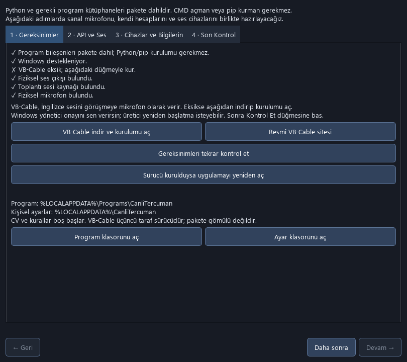
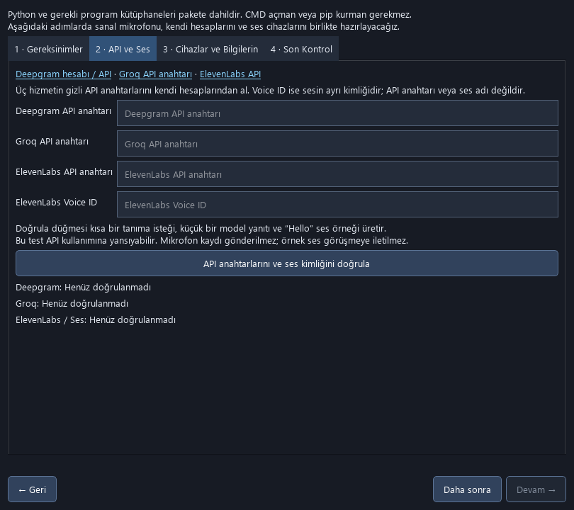

# Canlı Tercüman — Zoom, Discord, WhatsApp, Telegram

> **2 Kasım güncellemesi:** 1.1.2 test adayı da kurulumda **6/69**, iç uygulamada **6/71** tespit aldı. Güvenli sürüm olarak onaylanmadı; indirmeler kapalı.

> **İNDİRMELER ASKIYA ALINDI — 1 Kasım 2026:** 1.1.0 kurulum dosyasında Microsoft dahil birden fazla antivirüs motorunun uyarısı bildirildi. Neden henüz doğrulanmadı; güvenlik incelemesi tamamlanana kadar tüm kurulum sürümleri yayından kaldırıldı. Daha önce indirdiğin EXE’yi çalıştırma; antivirüsü kapatma veya istisna ekleme. İşlev testleri güvenlik doğrulaması değildir. [İnceleme ve açık kalan kontroller](docs/GUVENLIK_INCELEMESI.md).

**Türkçe konuş. İngilizce duyulsun. İstersen yanıtı otopilota bırak.**

Windows için iki yönlü canlı konuşma asistanı. Türkçe söylediklerini İngilizce seslendirir; İngilizce konuşmaları Türkçeye çevirir ve yanıt önerir. Otopilot açıkken kendi CV ve kurallarına göre İngilizce yanıtı otomatik seslendirir.

**Windows indirmesi güvenlik incelemesi süresince kapalıdır.** Sonuçlar: kurulumlar **7/57 ve 6/70**, iç uygulamalar **3/71 ve 3/71**. [Dört dosyanın raporu](docs/GUVENLIK_INCELEMESI.md). · [Sürümler](https://github.com/marwoziel/Canli-Tercuman-Zoom-Discord-WhatsApp-Telegram/releases)

## Kurulum kılavuzu — dağıtım yeniden açıldıktan sonra

Bu bölüm gelecekte onaylanan sürüm içindir; mevcut 1.0.0, 1.1.0 ve 1.1.1 EXE sürümleri inceleme nedeniyle dağıtılmıyor.

1. Güvenlik incelemesi tamamlanmış sürümün kurulumunu kullan. Python ve gerekli kütüphaneler dahildir; CMD/pip kullanmazsın.
2. İlk açılış sihirbazı gerekli cihazları ve VB-Cable'ı kontrol eder. Eksikse **VB-Cable indir ve kurulumu aç** düğmesine bas; Windows yönetici onayını verip üreticinin adımlarını tamamla. Gerekirse yeniden başlat.
3. **API ve Ses** adımında kendi anahtarlarını ve Voice ID değerini gir, **Doğrula** düğmesine bas. Program üç servise ve seçtiğin sese erişimi sınar; sorunlu alanı belirtir.
4. **Cihazlar ve Bilgilerin** adımında mikrofon/kulaklığı seç; yerel mikrofon, test tonu ve kendi sesinin örneğini deneyebilirsin. Kendi CV ve kuralların isteğe bağlıdır.
5. Görüşme uygulamasının mikrofonunu **CABLE Output** seç. **Son Kontrol** adımını tamamlayıp programı aç.

Doğrulama kullanıcı tarafından uygulamanın içinden yapılır. Kısa API testi kullanımına yansıyabilir; mikrofon kaydı buluta veya görüşmeye gönderilmez. VB-Cable üçüncü taraf sürücüsüdür: resmî sunucudan indirilir, yönetici onayı ve yeniden başlatma gerekebilir; sessizce kurulmuş gibi gösterilmez.

**Yeni başlayanlar:** [Sanal mikrofon dahil baştan sona kurulum](docs/BASTAN_SONA_KURULUM.md) · [API anahtarı alma bağlantıları](docs/API_ANAHTARLARI.md)

## İki mod

| Düğme | Ne yapar? |
|---|---|
| **Türkçe → İngilizce: AÇIK** | Sen Türkçe konuşursun; İngilizce çeviri seçtiğin sesle karşı tarafa gider. |
| **Otopilot: AÇIK** | İngilizce konuşma bittiğinde kendi CV ve kurallarına göre İngilizce yanıt hazırlanıp sesli gönderilir. |
| **F8** | Çalan sesi ve bekleyen yanıtı iptal eder. Otopilot açıksa sonraki yeni konuşmada tekrar devreye girer. |

İki mod aynı anda açılmaz. Otopilot her uygulama açılışında kapalıdır.

## Düşük kullanım maliyetiyle kendi hesabından çalıştır

API maliyetini kontrol et: kendi hesaplarını kullan, gereksiz açık mikrofonu kapat, yanıtları kısa tut. Açık varsayımlı örnek bir oturum yaklaşık **0,59 ABD doları kullanım bedeli** hesaplar; bu bir tarife veya garanti değildir. Plan ücretleri, vergiler, ses kredileri ve yeniden denemeler değişebilir. [Fiyat kaynakları ve örnek hesap](docs/MALIYETLER.md).

## Kişiselleştirme ve gizlilik

CV, kurallar, konuşma hafızası ve ses kimliği boş başlar; geliştiriciye ait örnek kişisel veri içermez. Kendi CV'ni **PDF Yükle**, tercihlerini **Kuralları Düzenle** üzerinden ekle. Ses için **Ses Kimliği**, hesaplar için **API Ayarları** düğmesini kullan.

API anahtarları Windows DPAPI ile bu kullanıcı hesabına bağlı olarak yerel saklanır. Konuşma sesi Deepgram'a, ilgili metin/CV/kurallar Groq'a, seslendirilecek metin ElevenLabs'e gönderilir. Bu çevrimdışı bir uygulama değildir. [Veri kullanımı](PRIVACY.md).

## Belgeler

- [Adım adım kullanım](docs/KULLANIM_KILAVUZU.md)
- [Zoom / Discord / WhatsApp / Telegram ses ayarı](docs/SES_YONLENDIRME.md)
- [Maliyet ve tasarruf](docs/MALIYETLER.md)
- [Sorun giderme](docs/SORUN_GIDERME.md)
- [Sürüm notları](CHANGELOG.md)

## GitHub ve fork

Bu depo **kurulum ve dokümantasyon deposudur**. Uygulamanın ham kaynak kodları yayımlanmaz. Depoyu forklayarak belgeleri, çevirileri ve dağıtım sayfasını geliştirebilirsin; uygulama kodunun geliştirilebilir bir fork'u burada bulunmaz. [Dağıtım koşulları](LICENSE.md).

Zoom, Discord, WhatsApp ve Telegram ile bağlantı, Windows ses cihazı yönlendirmesi üzerinden kurulur; bu servislerin resmî eklentisi değildir. Cihaz seçimi uygulama sürümüne göre değişebilir. Tam seslendirme gecikmesi ağ ve API yanıt süresine bağlıdır; canlı çıktı hatasızlık garantisi taşımaz.
